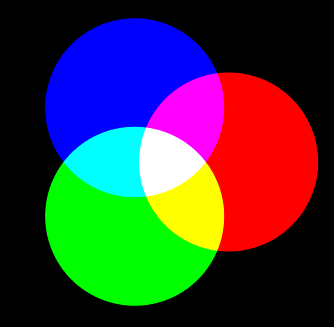

# tsfigure

**tsfigure** is a tool to create figures using Typescript. It can draw charts, diagrams, fractals and anything else you can describe with code.

The tsfigure language is designed to be powerful but readable. Being Typescript-based, it enjoys all the existing Typescript tooling: mature editors, smart autocompletion and efficient runtimes.

Currently tsfigure comes as a CLI tool that outputs SVG files.

## Example - Primary colors diagram

```ts
import { disk, Figure, polar, rgb } from "figure";

const spread = 0.7

let c1 = disk().radius(1).center(polar(spread, 0))
let c2 = disk().radius(1).center(polar(spread, 120))
let c3 = disk().radius(1).center(polar(spread, 240))

let figure = new Figure()

// Primary disks
figure.add(c1.fill(rgb(1, 0, 0)))
figure.add(c2.fill(rgb(0, 1, 0)))
figure.add(c3.fill(rgb(0, 0, 1)))

// Intersections of two disks
figure.add(c1.clip(c2).fill(rgb(1, 1, 0)))
figure.add(c2.clip(c3).fill(rgb(0, 1, 1)))
figure.add(c3.clip(c1).fill(rgb(1, 0, 1)))

// Intersection of all three
figure.add(c3.clip(c1).clip(c2).fill(rgb(1, 1, 1)))

figure = figure.scale(0.5)
export { figure }
```

Running tsfigure will create:



## Quick start

1. Install [Deno](https://deno.com)
2. Clone this repository
3. `deno --allow-read --allow-write tsfig.ts examples/<example>.ts`
4. Open `examples/<example>.ts.svg`